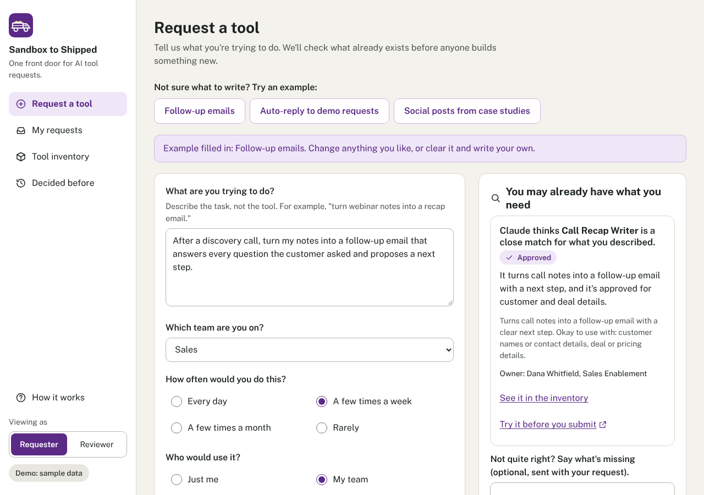
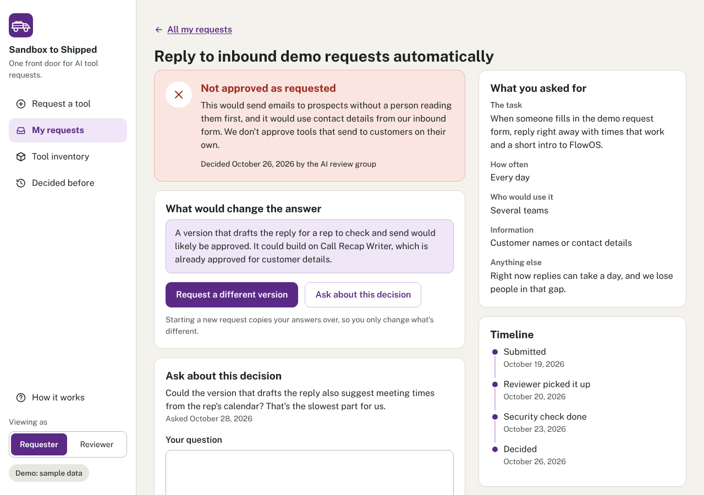
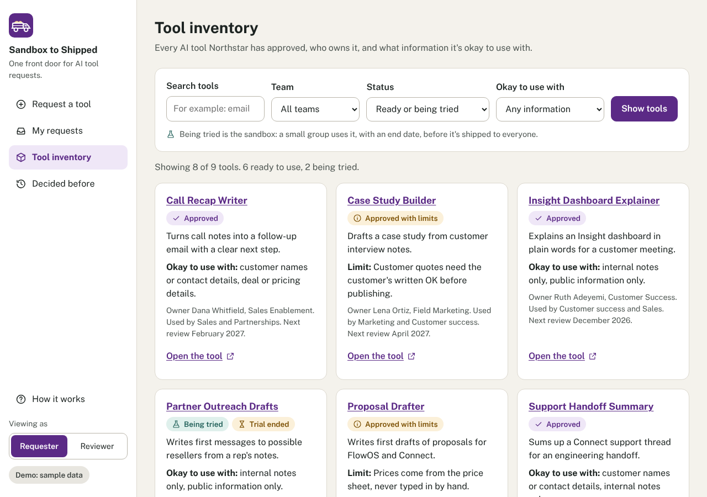
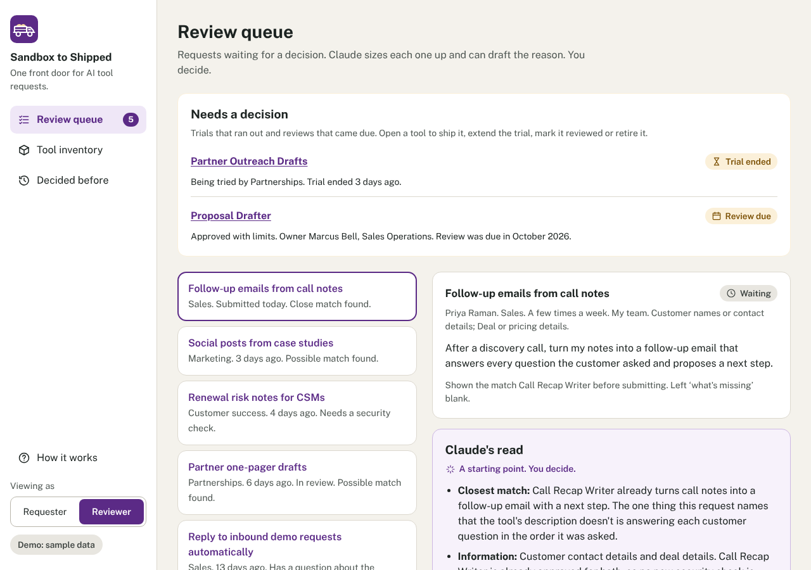
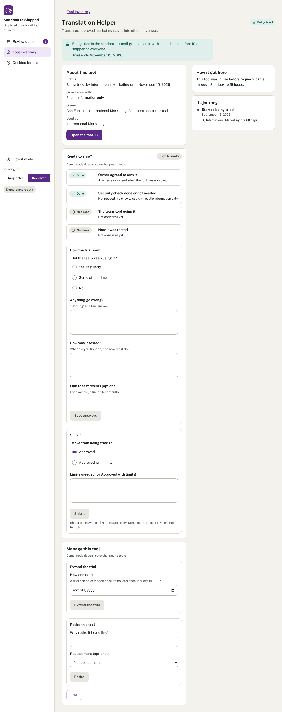
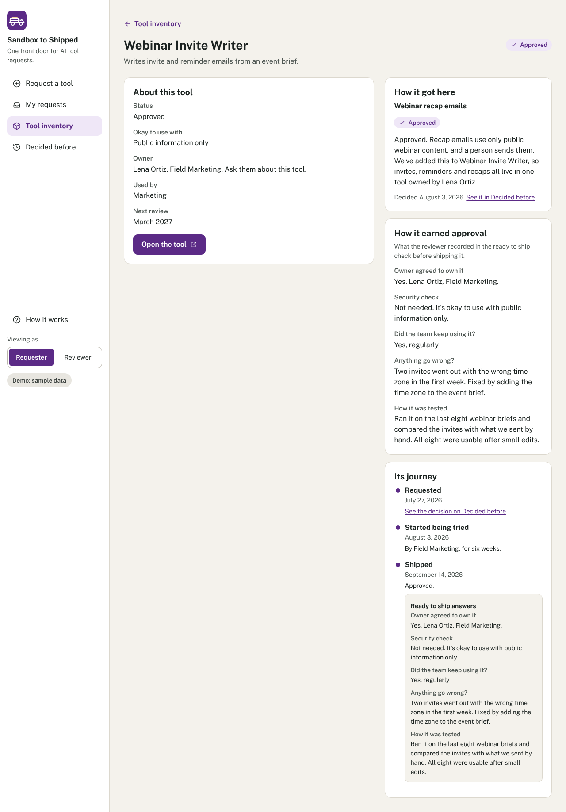
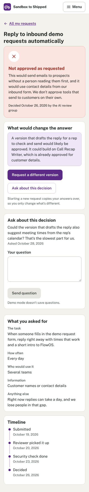

# Sandbox to Shipped

**One front door for AI tool requests.**

Sandbox to Shipped is a small web app that gives a company one place to ask for AI tools. Anyone can ask for a tool, see right away whether an approved tool already does the job, and later see the decision with a plain reason. Reviewers get one queue, a short checklist and a reason Claude drafts for them to edit. Approved tools land in a shared inventory and start in the sandbox, labeled "being tried". They are shipped to approved only after a short ready to ship check: from sandbox to shipped.

The demo uses a fictional company, Northstar Systems, and its products FlowOS, Connect and Insight. Every person and tool in it is made up.



## The problem

When people want an AI tool, they ask in chat, in email, in a hallway. The same idea gets asked for three times. Answers take weeks, and when the answer is no, nobody says why or what would make it a yes. Meanwhile the company may already have a tool that does the job, and nobody knows who owns it.

## Who it is for

- **Requesters:** marketers, sellers, support staff, anyone with an idea for an AI tool. They want a fast answer, and if the answer is no, a reason and a way forward. They never need GitHub, files or a terminal.
- **Reviewers:** the person who leads AI tools for the company, plus someone from security when a request touches customer data. They want fewer duplicate requests, a consistent way to decide, and less time writing explanations.
- **Tool owners:** the person responsible for a tool after it is approved, listed in the inventory so people know who to ask.

## How it works

1. **Request a tool.** Someone describes the task (not the tool), their team, how often they'd do it, who would use it and what information it would touch.
2. **Check what exists.** As they type, the app shows up to two approved tools that may already do the job, and how sure Claude is. If a match is close but not quite right, they say what's missing.
3. **A reviewer decides.** The request lands in the review queue with Claude's quick read. The reviewer answers a four-question checklist, picks an outcome and edits a reason Claude drafted. The requester sees the decision, the reason and what would change the answer.
4. **Being tried (the sandbox).** An approved tool starts as being tried by one team, with an owner who agreed to own it and a trial end date.
5. **Ready to ship check.** On the tool's page, a reviewer works through four items: the owner agreed, security is covered, the team kept using it, and how it was tested. "Ship it" stays off until all four are done.
6. **Approved.** The reviewer ships it to approved (or approved with limits). The tool page keeps the answers under "How it earned approval", and every tool shows its journey from request to today.

Trials that run past their end date and reviews that come due show up under **Needs a decision** at the top of the review queue, so nothing sits in the sandbox or the inventory forever. When someone types a request, the app also shows a related past decision, if there is one, as **Asked before**.

Every past decision is listed on **Decided before**, without the requester's name, so nobody has to ask twice.

## Design choices and why

1. **One front door.** Requests, decisions and approved tools live in one place, so nobody has to chase an answer in chat.
2. **Check what exists first.** Before anyone submits, the app shows approved tools that may already do the job. Often the best answer is a tool the company already has.
3. **A person decides every request.** Claude sizes up requests, suggests matches and drafts reasons. It never approves or turns down anything on its own.
4. **Every "no" comes with a reason and a path.** Each decision says why, and what would change the answer.
5. **Ask what people actually know.** The form asks how often and who would use it, not how many hours it would save, because people guess hours badly.
6. **Past decisions are open, requesters stay private.** "Decided before" shows every past decision and its reason so people do not ask twice, but never shows who asked.
7. **Owners agree to be owners.** Nobody is listed as a tool owner unless they agreed to it.
8. **Shipped means it earned it.** Every new tool starts in the sandbox, labeled being tried: one team, a named owner and an end date. It moves to approved only after a reviewer confirms the owner agreed, security is covered, the team kept using it, and how it was tested. Trials that run out and reviews that come due are flagged, so nothing sits in the sandbox or the inventory forever.
9. **Demo mode uses the real logic.** It runs recorded Claude results through the same matching, checklist and decision code as live mode.
10. **Honest about the alternative.** The cheapest version of this is a shared form and a spreadsheet. This app earns its place with the check for existing tools, drafted reasons, and a decision history people can search.

## What you can try in the demo

The public demo is open to anyone. A visitor can use every page, switch between Requester and Reviewer, see Claude's matches and drafted reasons from recorded results, and work through the review steps: the checklist, the ready to ship check, Needs a decision and each tool's journey. Nothing is saved and nothing is sent to Claude. The buttons that would save something are turned off, with a line saying why.

Some things to try:

- On **Request a tool**, the prefilled example finds Call Recap Writer. Replace the text with "auto-reply to demo requests" to see an **Asked before** card.
- As a reviewer, open **Translation Helper** to see the Ready to ship card at 2 of 4, with Ship it turned off.
- The **Review queue** starts with Needs a decision: Partner Outreach Drafts (trial ended) and Proposal Drafter (review due).
- **Webinar Invite Writer** shows a full journey and how it earned approval.

Demo dates are stored as offsets from today, so the examples always look current.

## What was tested with saving turned on

Live mode was tested with a stand-in for Claude: the tests swap in a fake client that returns fixed answers, then save requests, decisions, ready to ship answers, trial extensions, reviews and retirements to a real SQLite file and read them back. The shape of each Claude request was checked in those tests too. The app has not yet been run against the real Claude API.

## Run it

You need Python 3.12 or newer.

```bash
pip install -e ".[dev]"
```

### Demo mode (no key needed)

Demo mode is the default. It needs no API key, makes no calls to Claude and saves nothing. It loads the sample data in `demo/` fresh on every start, so anyone can click around without breaking anything.

```bash
sts serve
```

Open http://localhost:8080. Use **Viewing as** at the bottom of the sidebar to switch between Requester and Reviewer.

### Live mode

Live mode calls Claude and saves requests, decisions and tool changes to a SQLite file in `DATA_DIR`. Copy `.env.example` to `.env` (it is ignored by git) or set the variables in your shell:

```bash
export STS_MODE=live
export ANTHROPIC_API_KEY=your-key-here
export DATA_DIR=./data
```

Optionally load the sample data into the database first. It asks before replacing anything:

```bash
sts seed --reset
```

Then start the app:

```bash
sts serve
```

On the first visit the app asks for a display name. It is stored in a browser cookie and used as the requester or reviewer name.

If `STS_MODE=live` is set but `ANTHROPIC_API_KEY` is missing, the app falls back to demo mode and shows a notice. The key is only read on the server; it is never sent to the browser, logged or committed.

| Variable | Default | What it does |
| --- | --- | --- |
| `STS_MODE` | `demo` | `demo` or `live`. Demo stays demo even when a key is present. |
| `ANTHROPIC_API_KEY` | (empty) | Needed for live mode. |
| `STS_MODEL` | `claude-sonnet-5-5` | The Claude model used in live mode. |
| `DATA_DIR` | `./data` | Folder for the SQLite file in live mode. |
| `PORT` | `8080` | Port the server listens on. |

### Check the demo data

```bash
sts check-data
```

Problems are reported with the file and field, for example `demo/tools.yaml, tools[8].status: Input should be 'being_tried', 'approved', 'approved_with_limits' or 'retired'`.

### Run the tests

```bash
pytest
```

The tests cover the matching rules, every decision rule, the ready to ship check (Ship it refused on the server until all four items are done), extending a trial, Retire, Mark reviewed, Trial ended and Review due at the date edges, the badge count, Asked before, each tool's journey, demo dates relative to today, upgrading a database from the first version, copying a request, privacy on Decided before, demo mode making no network calls and saving nothing, demo data checks, the 5,000 character limit, the plain-language word list and a scan for em dashes. Live mode is tested with a fake Claude client, so the tests never call the real API. A GitHub Actions workflow runs them on every pull request.

### Run with Docker

```bash
docker build -t sandbox-to-shipped .
```

```bash
docker run -p 8080:8080 -e STS_MODE=demo sandbox-to-shipped
```

The container serves on `PORT` (default 8080). `/health` returns `ok`.

## Deploying to Railway

The public site should stay in demo mode. These steps assume you have a Railway account and the code in a GitHub repository.

1. In Railway, click **New Project**, then **Deploy from GitHub repo**, and pick this repository. Railway may ask you to connect GitHub the first time.
2. Railway finds the `Dockerfile` at the root of the repo and builds from it. You don't need a config file.
3. Open the new service, go to **Variables** and add `STS_MODE` with the value `demo`.
4. Go to **Settings**, find the health check setting and set the path to `/health`. Railway then waits for the app to answer before switching traffic to a new deploy.
5. Still in **Settings**, under **Networking**, click **Generate Domain** to get a public web address.
6. Open the address. You should see Request a tool with the "Demo: sample data" label in the sidebar.

Railway sets the `PORT` variable for you, and the app listens on it.

**Live mode on Railway needs a volume.** Without one, saved data is lost every time the app redeploys. Add a volume to the service, mount it at a path such as `/data`, and set `DATA_DIR=/data` along with `STS_MODE=live` and `ANTHROPIC_API_KEY`. Keep the public deployment in demo mode, and remember a live instance has no sign-in (see Known limitations).

## Under the hood

For technical readers, here is how the plain words in the app map to familiar ideas.

- **Requests** are an intake queue. Each request records what the requester saw before submitting (the matches and their "what's missing" note), Claude's read, a timeline and any questions.
- **The existing-tool check** is retrieval plus an LLM match with id validation. Claude gets the inventory of tools that are approved, approved with limits or being tried, and returns up to two tool ids with a confidence of "close" or "possible". Code then drops any id that is not in that inventory, so a made-up or retired tool can never appear. In demo mode, recorded results or a simple word-overlap match go through the same validation.
- **The reviewer** is a human-in-the-loop approval step. Claude's structured outputs have no outcome field, the outcome only ever comes from the reviewer's form, and a test scans the code for any assignment of an outcome.
- **"Being tried"** is a sandbox stage. Every approval creates a tool in that state, with an owner who agreed and a trial end date. "Ship it" promotes it.
- **The ready to ship check** is a promotion gate enforced on the server. `ship_tool()` in `sts/rules.py` refuses until all four items are done, and refuses outright when the team stopped using the tool, whatever the page shows. Extending (once, up to 60 days) and retiring (with a reason) are always open.
- **Needs a decision** is stale-item monitoring: trials past their end date and approved tools past their review month are flagged on the tool page, in the inventory and at the top of the review queue, and counted in the sidebar badge.
- **Asked before** is retrieval over past decisions with id validation. The same match call that suggests tools gets the past decisions (title, task, outcome, reason, what would change; never the requester's name) and may return one decision id with a reason. Code drops any id that was not in the list sent. In demo mode, recorded results or a word-overlap match go through the same check.
- **Each tool's journey** is an event log kept on the tool (requested, started being tried, security check done, trial extended, shipped, reviewed, retired), shown as an ordered list.
- **Database upgrades** run on startup in live mode: new columns are added to a database from the first version without touching existing rows, and existing tools get a journey built from their request, decision and status.
- **Decided before** is a public decision log with requester privacy. The page is built only from the title, outcome, reason, what would change and date; a test checks that no requester name is rendered.

Code layout:

| Path | What it holds |
| --- | --- |
| `sts/provider.py` | Every Claude call (find_matches, size_up, draft_reason) and the demo player. The only file that talks to Claude. |
| `sts/matching.py` | Match validation and the demo word match. |
| `sts/rules.py` | The checklist and decision rules, the ready to ship check, Ship it, Extend, Retire, Mark reviewed, Trial ended and Review due, copying a request. |
| `sts/store.py` | Demo store (in memory, read only) and live store (SQLite via SQLModel). |
| `sts/web.py` | FastAPI routes. Pages are server-rendered Jinja2 templates in `templates/`. |
| `sts/cli.py` | The `sts` command. |
| `demo/` | `tools.yaml`, `requests.yaml` and `recorded/<request-id>.json` (recorded Claude output). Dates are offsets from today, such as "3 days ago" or "in 2 weeks". |

Claude calls use the official `anthropic` Python SDK with structured outputs (`messages.parse` with a Pydantic model), so every response parses. Request text is wrapped in `<request_data>` delimiters and Claude is told to treat it as data and ignore any instructions inside it. Matching and size-ups use low effort for quick, steady answers; current Claude models no longer accept a temperature setting, so effort is the lever instead. Calls opt in to the API's default refusal fallback.

The interface is plain HTML and CSS with a little vanilla JavaScript (the live match check and the "Draft the reason for me" button). Every form also works without JavaScript, and the phone menu is a `details` element.

## Screenshots

Request a tool, with the match panel:


A request that was not approved as requested, with the reason and what would change the answer:



Tool inventory:



Review queue, with Needs a decision at the top, then Claude's read and the checklist:



A being tried tool, Translation Helper, with the Ready to ship card at 2 of 4:



Webinar Invite Writer, with how it earned approval and its journey:



A request page at phone width:



To refresh them, start the app in demo mode and run `node scripts/screenshots.js` (needs Playwright).

## Known limitations

- **No real sign-in.** "Viewing as" and the display name are cookies anyone can change, so a live instance is for one person or a trusted team. Real sign-in would be the first thing to add.
- **Claude's matches can be wrong or miss a tool.** That's why a reviewer sees what the requester was shown and makes the call.
- **The demo's word match is much simpler than live mode.** Only the prefilled example uses recorded Claude results.
- **A single SQLite file suits a small team, not a large company.**
- **On Railway, live data needs a volume,** or it is lost on each deploy.
- **Decided before is visible to everyone,** so reasons should be written for a wide audience.
- **Demo data is fictional and hand-written,** including the recorded Claude output.
- **The ready to ship answers are recorded by the reviewer, not measured by the app.** "The team kept using it" is the reviewer's answer, not usage data.
- **Test results are a link, not checked by the app.** The app only checks that it is an http or https address.
- **Live mode has not been run against the real Claude API yet.** See "What was tested with saving turned on".
