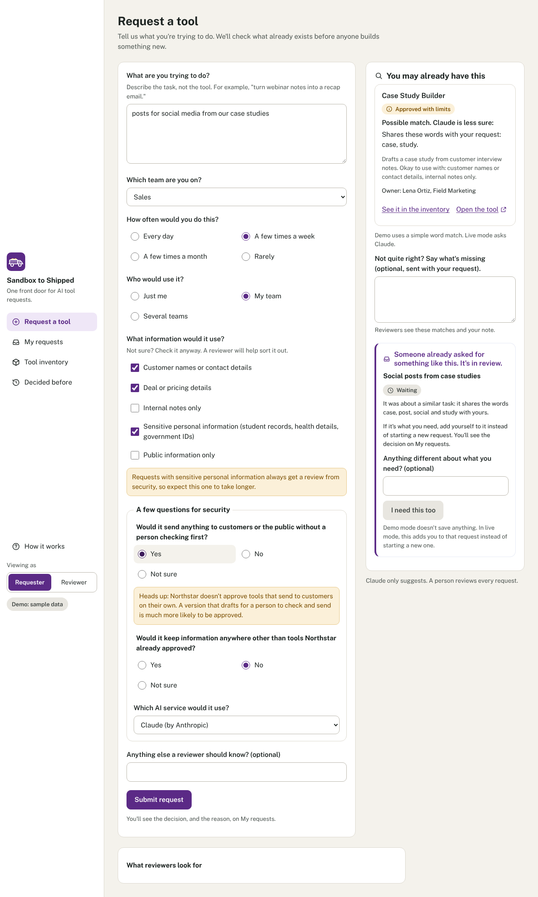
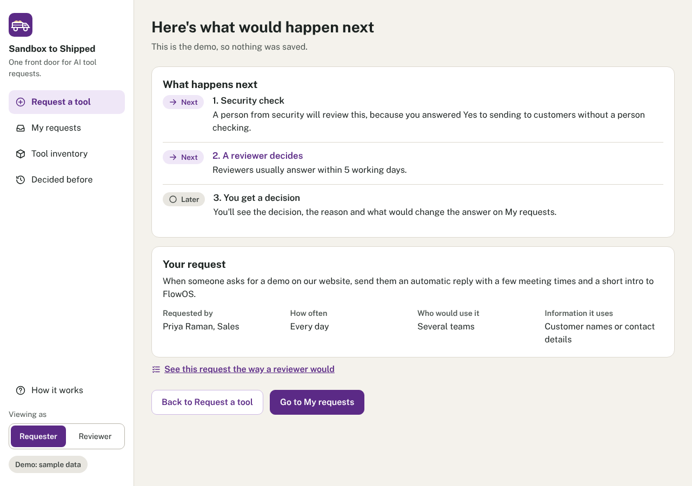
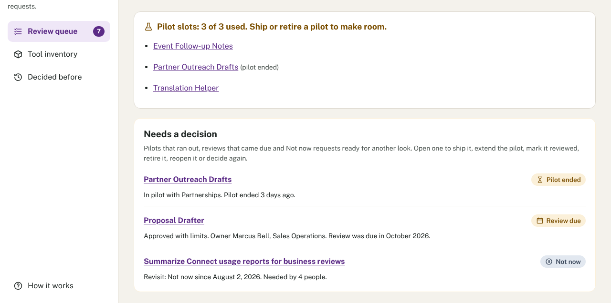
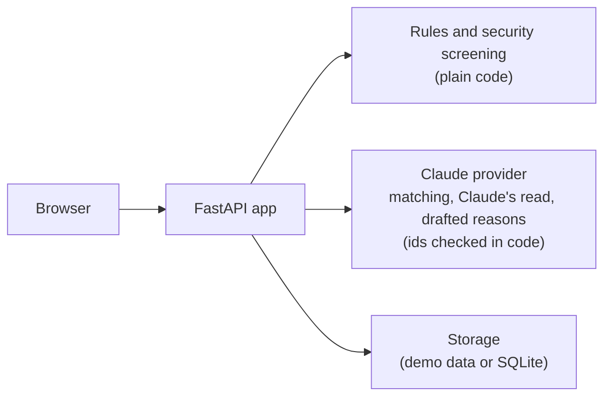

# Sandbox to Shipped

Sandbox to Shipped helps teams turn scattered AI requests into accountable decisions: checking existing tools first, screening for security, and moving pilots toward approval or retirement. AI assists with discovery and explanations. People make decisions. Code enforces the gates.

Try it live: https://sandbox-to-shipped-103749504031.us-east1.run.app

Matching and Claude's read use real Claude there, within daily limits, and nothing is saved. See [what to try](docs/try-it.md).

[](https://github.com/jmims-workflow/Sandbox-to-Shipped/actions/workflows/tests.yml)

## The problem

When people want an AI tool, they ask in chat, in email, in a hallway. The same idea gets asked for three times. Answers take weeks, and when the answer is no, nobody says why or what would make it a yes. Meanwhile the company may already have a tool that does the job, and nobody knows who owns it.

## Who it's for

- **Requesters:** marketers, sellers and support staff with an idea. They want a fast answer and, if it's no, a reason and a way forward, with no GitHub, files or terminal.
- **Reviewers:** whoever leads AI tools, plus security when a request needs a person.
- **The security team:** they write the rules the app applies.
- **Tool owners:** listed so people know who to ask.

The demo company, Northstar Systems, and everyone in it are fictional.

## Walkthrough


Recorded on a local copy in live mode, with a stand-in for Claude so the run is repeatable. In this single-user prototype, the same person switches between requester and reviewer; a real deployment would need sign-in and roles (see [docs/production.md](docs/production.md)).

It shows what the public site can't, because it saves nothing: both server refusals, a pilot and a shipped tool. [Watch it as a video](docs/walkthrough.mp4). To record it again, run `node scripts/walkthrough.js` (needs Node, Playwright and ffmpeg).

<details>
<summary>Screenshots</summary>










</details>

## What I built

- **Request a tool:** asks about the task, not the tool. As people type, Claude suggests approved tools that may already do the job, a related past decision, or a request to join with "I need this too".
- **Here's what happens next:** three steps, with this request's security screening result.
- **Review queue:** pilot slots and overdue items at the top; each request has its screening result, Claude's read, a short checklist and a reason Claude drafts for the reviewer to edit.
- **My requests:** the decision, the reason and what would change the answer.
- **Tool inventory:** every approved tool and its owner. Pilots have the ready to ship check; every tool shows its journey.
- **Decided before:** past decisions and reasons, with requester names omitted.

## My role

I created Sandbox to Shipped to address a problem I've encountered in my own work: teams need better ways to evaluate AI tool requests, avoid building what already exists, and make consistent decisions about what gets approved.

I led the product design and directed the build, using Claude for planning and Claude Code for implementation.

### The decisions I owned

- **Problem and scope:** I evaluated potential AI applications against real organizational needs and chose to focus on the process of requesting, reviewing, and approving AI tools. Checking what's already available comes from my own experience helping teams adopt new workflows.
- **Human oversight:** AI can identify possible matches, assess requests, and draft explanations. People make the decisions, and application rules enforce the required checks.
- **Fair and consistent decisions:** I designed the review process around documented standards, security requirements, pilot capacity, and clear explanations. A request that isn't approved should still have a useful next step.
- **Practical adoption:** I chose to ask employees questions they can reasonably answer rather than requiring speculative time-savings estimates. I also designed privacy, ownership consent, and uncertainty into the app.
- **User experience:** I directed the navigation, visual design, and language to make the application approachable for people who don't have technical backgrounds.

### How I worked with AI

I used Claude as a planning and critical-thinking partner to challenge assumptions, explore alternatives, develop screen concepts, and translate my decisions into detailed specifications. Claude Code wrote the application code and automated tests.

I also sought independent reviews, evaluated the recommendations, and incorporated changes that materially improved the application.

### How I tested and refined it

I reviewed change summaries and test results before merging updates, then tested the deployed application myself.

That hands-on testing caught usability problems that automated checks didn't, including a prefilled form that made the example confusing and a confirmation page that didn't clearly explain what happened next. I used those findings to direct further revisions.

I also configured the Google Cloud Run deployment, including API key storage through Secret Manager and spending controls.

### What I deliberately left out

I kept the public demo focused on demonstrating the application's decision process without requiring accounts or storing visitor submissions.

Real authentication and role-based access, persistent hosted storage, and durable usage limits would be necessary for a multi-user production deployment. I've documented those requirements in [the production roadmap](docs/production.md).

### What this project demonstrates

My strength is identifying workflow problems, designing practical AI-supported solutions, and guiding them from concept through implementation and testing. I bring business process knowledge, product judgment, and hands-on experience directing AI-assisted development, rather than a traditional software engineering background.

## Design choices

- **One front door.** Requests, decisions and approved tools live in one place.
- **Check what exists first.** Often the best answer is a tool the company already has.
- **A person decides every request.** Claude suggests and drafts; it never approves or turns down anything.
- **Security writes the security rules.** Code applies them, and sensitive information always goes to a person.
- **Every "no" comes with a reason and a path.** Each decision says what would change the answer.
- **Ask what people actually know.** How often and who would use it, not guessed hours saved.
- **One request per idea.** "I need this too" shows demand instead of three copies.
- **Past decisions are open, with requester names omitted.** Titles, tasks and reasons are visible to everyone.
- **Owners agree to be owners.** Nobody is listed as an owner without agreeing.
- **Shipped means it earned it.** Every new tool starts as a pilot and ships only after the ready to ship check.
- **Room is part of the standard.** Only a set number of tools can be in pilot at once, and the limit is shown openly.
- **Demo mode uses the real logic.** Recorded results run through live mode's code.
- **Honest about the alternative.** The cheapest version is a form and a spreadsheet; this app has to earn its place.

Why standards. Every "no" in this app points to something written down: security's rules, the review checklist, the number of pilot slots, or a past decision. The idea, borrowed from Stuart Diamond's Getting More, is that a decision should rest on an agreed standard, so the conversation is about the standard and not about anyone's feelings. It also means no single reviewer has to be the bad guy.

The full explanations are in [docs/design.md](docs/design.md).

## How it works



Every gate (security screening, pilot slots, the ready to ship check) is enforced in plain code on the server. Claude's answers have no outcome field, and any id Claude returns that wasn't in the list it was sent is dropped. See [docs/architecture.md](docs/architecture.md) for the rules, Claude calls and data model.

## Testing

[](https://github.com/jmims-workflow/Sandbox-to-Shipped/actions/workflows/tests.yml)

375 tests pass. They cover every decision and screening rule, saving in live mode, the preview limits, privacy and plain language, using a stand-in for Claude, never the real API. The [walkthrough](docs/walkthrough.mp4) is the end-to-end demonstration; [docs/testing.md](docs/testing.md) has the detail.

Matching quality is measured against 32 labeled cases, run three times each against the real model. Claude's top suggestion was right in 96% of runs (the simple word match: 75%), it found every tool it should have, and no injected instruction got through. Its main weakness: in about 1 in 5 runs it shows an unrelated past decision under Asked before. Full results are in [evals/](evals/README.md).

## Limitations and the production path

- **No real sign-in or roles.** "Viewing as" is a cookie anyone can change.
- **No lasting storage on the public site.** It runs in preview mode and saves nothing; live mode uses one SQLite file.
- **Preview limits are counted in memory** on one server and reset when it restarts.
- **Security screening relies on the requester's answers.** A reviewer can still send a request to a person.
- **Matching is measured only by hand,** on a small set written by the builder.

The full production path is in [docs/production.md](docs/production.md); none of it is built.

## Part of a set

Sandbox to Shipped is one of three apps that follow an AI tool through its life at a company:

- Sandbox to Shipped (this repo): should we build or approve this AI tool?
- [Rollout Ready](https://github.com/jmims-workflow/Rollout-Ready): does a change to the tool's prompt make it better or worse before the team sees it?
- [AI Adoption & Impact Tracker](https://github.com/jmims-workflow/ai-adoption-tracker): once it's live, are people using it, and is it helping?

They are separate apps with no shared code. Together they cover deciding, testing and measuring.

## Quick start

Demo mode needs no key and saves nothing. With Python 3.12 or newer:

```bash
pip install -e ".[dev]"
```

```bash
sts serve
```

Open http://localhost:8080; **Viewing as** in the sidebar switches between Requester and Reviewer. Deploying: [docs/deploy.md](docs/deploy.md). Preview, live mode and settings: [docs/configuration.md](docs/configuration.md).
