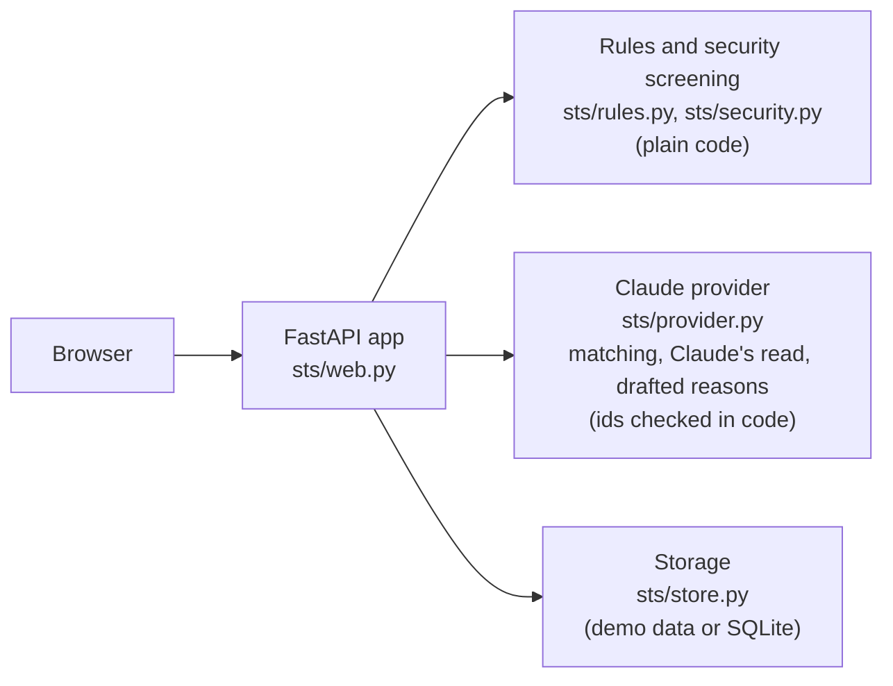

# How it works, under the hood

[Back to the README](../README.md)

This page has the full detail: each step of the journey, the rules, the Claude calls and the data model. For technical readers, "Under the hood" maps the plain words in the app to familiar ideas.

## The journey, step by step

1. **Request a tool.** The form starts empty, with three example buttons above it for anyone not sure what to write. Someone describes the task (not the tool), their team, how often they'd do it, who would use it and what information it would touch. If it uses anything other than public information, three short questions for security appear.
2. **Check what exists.** As they type, the app shows up to two approved tools that may already do the job, leading with the outcome: "Claude thinks Call Recap Writer is a close match for what you described." If a match is close but not quite right, they say what's missing in the same form. If someone already asked for the same thing and it's still in review, they can say **I need this too** instead of starting a new request.
3. **Security screening runs.** Plain code applies security's rules to the answers. See "Automatic security screening" below.
4. **A reviewer decides.** After sending, the requester sees "Here's what happens next": three steps (security screening with this request's real result, a reviewer decides, you get a decision), each marked Done, Next or Later. The request lands in the review queue with Claude's quick read (only reviewers see it) and the security screening result. The reviewer answers a four-question checklist, picks an outcome and edits a reason Claude drafted. The requester sees the decision, the reason and what would change the answer. A good idea at the wrong time can get **Not now**, with a date to look again.
5. **Pilot.** An approved tool starts as a pilot with one team, an owner who agreed to own it and an end date.
6. **Ready to ship check.** On the tool's page, a reviewer works through four items: the owner agreed, security screening is done or not needed, the team kept using it, and how it was tested. "Ship it" stays off until all four are done.
7. **Approved.** The reviewer ships it to approved (or approved with limits). The tool page keeps the answers under "How it earned approval", and every tool shows its journey from request to today.

Pilots that run past their end date and reviews that come due show up under **Needs a decision** at the top of the review queue, so nothing sits in a pilot or the inventory forever. When someone types a request, the app also shows a related past decision, if there is one, as **Asked before**.

Every past decision is listed on **Decided before**, with requester names omitted, so nobody has to ask twice. Titles, tasks and reasons are visible to everyone.

### Pilot slots

Only a set number of tools can be in pilot at once: three by default (`STS_PILOT_SLOTS`). Every tool in pilot uses a slot, even after its end date, until it is shipped or retired. The top of the review queue shows "Pilot slots: 2 of 3 used" with a link to each pilot. When every slot is in use, it says "Pilot slots: 3 of 3 used. Ship or retire a pilot to make room.", and Approve and Approve with limits are turned off in the decision form with the line "All 3 pilot slots are in use. Ship or retire a pilot first, or choose Not now." The server refuses those approvals too. Extending a pilot doesn't need a free slot.

### Not now

Not now is for a good idea at the wrong time. It needs a reason, what would change the answer and a date to look again, no more than 6 months away (3 months by default). The requester sees "Not now. We'll look at this again in March 2027." with the reason. People can still say **I need this too** on a Not now request, so demand keeps counting. On the revisit date, the request appears under **Needs a decision**: "Revisit: Not now since August 2, 2026. Needed by 4 people." The reviewer can reopen it (it goes back to waiting, keeping its history) or decide again. Decided before shows Not now decisions with their revisit month.

### Automatic security screening

The security team owns one file, `security_rules.yaml`. It lists the AI services security has approved (for Northstar: Claude, and Meridian Assist, Northstar's private instance) and, for each kind of information, one of three rules: no screening, automatic screening, or always a person.

When a request uses anything other than public information, the form asks three questions:

- Would it send anything to customers or the public without a person checking first? (Yes, No, Not sure)
- Would it keep information anywhere other than tools Northstar already approved? (Yes, No, Not sure)
- Which AI service would it use? (the approved services, Something else, or Not sure)

Then the app works out the result, in code:

- **Only public information:** "Security screening: not needed".
- **Any sensitive personal information** (student records, health details, government IDs): "Security screening: a person from security will review this", whatever the answers.
- **Otherwise** it passes automatically only when the first two answers are No and the service is an approved one: "Security screening: passed automatically against security's rules".
- **Any Yes, Not sure or unapproved service** sends it to a person, and the result names which answer did.

The result is saved with the request, shown in the review queue and fills the security item in the reviewer's checklist. A reviewer can still change "Passed automatically" to "Needed". No tool is approved while security screening is Needed: the server refuses with "Finish the security screening before approving." Claude is not involved in screening.

Today, screening relies on the requester's answers. [The production path](production.md) covers what a real deployment would add.

### What reviewers look for, and early warnings

Under the form, a collapsible **What reviewers look for** section lists the short version: whether a tool we have already does it, whether it would send anything to customers on its own (Northstar doesn't approve that), what information it uses under security's rules, that approved tools start as a pilot, and how much room there is for new pilots.

Two plain warnings appear next to the answers that trigger them, before anyone submits. They come from rules in code, never from Claude, and they are never a score or a prediction. The requester can always submit anyway.

- Sends to customers without a person checking: "Heads up: Northstar doesn't approve tools that send to customers on their own. A version that drafts for a person to check and send is much more likely to be approved."
- Sensitive personal information: "Requests with sensitive personal information always get a review from security, so expect this one to take longer."

## Under the hood

For technical readers, here is how the plain words in the app map to familiar ideas.

- **Requests** are an intake queue. Each request records what the requester saw before submitting (the matches and their "what's missing" note), the answers to the security questions and the screening result, Claude's read, a timeline, any questions and anyone added with "I need this too".
- **The existing-tool check** is retrieval plus an LLM match with id validation. Claude gets the inventory of tools that are approved, approved with limits or in pilot, and returns up to two tool ids with a confidence of "close" or "possible". Code then drops any id that is not in that inventory, so a made-up or retired tool can never appear. In demo mode, recorded results or a simple word-overlap match go through the same validation.
- **Automatic security screening** is a policy-as-code rule set. `security_rules.yaml` is validated with Pydantic at startup (unknown keys, missing information kinds, bad values and duplicate service ids are all reported with the field), and `check_security()` in `sts/security.py` applies it. No model is called. The early warnings on Request a tool come from the same module. Internally the step is still called the security check (`security_check`, `security_answers`, `security_result`).
- **The reviewer** is a human-in-the-loop approval step. Claude's structured outputs have no outcome field, the outcome only ever comes from the reviewer's form, and a test scans the code for any assignment of an outcome. `validate_decision()` blocks approvals while screening is Needed, and only accepts "Passed automatically" for requests that passed.
- **I need this too** is deduplication. The same match call also gets the requests still waiting or in review (id, title and task; never names) and may return one id with a reason. Code drops any id not in the list sent, and leaves out the person's own requests. Adding a person is a server-side rule (`add_needed_by()`): once per person, never to their own request, only while it's open.
- **Pilot** is a sandbox stage (internally `being_tried`). Every approval creates a tool in that state, with an owner who agreed and an end date (`trial_ends`). "Ship it" promotes it.
- **The ready to ship check** is a promotion gate enforced on the server. `ship_tool()` in `sts/rules.py` refuses until all four items are done, and refuses outright when the team stopped using the tool, whatever the page shows. Extending (once, up to 60 days) and retiring (with a reason) are always open.
- **Needs a decision** is stale-item monitoring: pilots past their end date and approved tools past their review month are flagged on the tool page, in the inventory and at the top of the review queue, and counted in the sidebar badge. Not now requests whose revisit date has arrived join them.
- **Pilot slots** are a work-in-progress limit enforced on the server. `slot_count()` in `sts/rules.py` counts every tool in `being_tried`, and `validate_decision()` refuses Approve and Approve with limits while every slot is in use, whatever the page sent. Extending a pilot never checks slots.
- **Not now** is a deferral with a scheduled revisit. The decision stores `revisit_on` (validated to be after today and within 6 months). `revisit_due()` puts the request back under Needs a decision on that date, and `reopen_request()` sends it back to waiting. Every decision is kept, and the newest one counts.
- **Asked before** is retrieval over past decisions with id validation. The same match call gets the past decisions (title, task, outcome, reason, what would change; requester names omitted) and may return one decision id with a reason. Code drops any id that was not in the list sent.
- **Live preview** wraps the Claude provider with an in-memory rate limiter: a daily counter that rolls over at midnight UTC and a sliding one-hour window per visitor, keyed by a salted SHA-256 hash of the visitor's address (the first `X-Forwarded-For` entry on Cloud Run). Over the limit, or if Claude can't answer, it uses the demo provider. The store is the read-only demo store, so nothing can be saved.
- **Each tool's journey** is an event log kept on the tool (requested, pilot started, security screening done, pilot extended, shipped, reviewed, retired), shown as an ordered list.
- **Database upgrades** run on startup in live mode: new columns are added to a database from an earlier version without touching existing rows, and existing tools get a journey built from their request, decision and status. Request timelines saved before the wording change say "Security check done"; both labels count.
- **Decided before** is a public decision log with requester names omitted. The page is built only from the title, outcome, reason, what would change and date; a test checks that no requester name is rendered. It is not anonymous in a wider sense: the title, task and reason are visible to everyone.
- **The stand-in for Claude** (`sts/fake_claude.py`) is a fake client that returns fixed structured answers. The tests use it, and so does the recorded walkthrough through the development-only `STS_FAKE_CLAUDE=1` setting, which the app refuses in demo or preview mode or when a real key is set.

## The Claude calls

All Claude calls live in `sts/provider.py`. There are three:

| Call | What Claude gets | What comes back | What code checks |
| --- | --- | --- | --- |
| `find_matches` | The task and information kinds, the eligible inventory, past decisions (requester names omitted) and open requests (id, title, task) | Up to two tool ids with "close" or "possible" and a reason; optionally one past decision id and one open request id | Any id not in the list sent is dropped |
| `size_up` (Claude's read) | One request and the inventory | A short title and two to four labeled bullets | Shown to reviewers only; it never decides security screening |
| `draft_reason` | The request, the outcome the reviewer picked, the checklist, the chosen tool and limits | A reason and what would change the answer | The reviewer edits it; no outcome field exists |

Claude calls use the official `anthropic` Python SDK with structured outputs (`messages.parse` with a Pydantic model), so every response parses. Request text is wrapped in `<request_data>` delimiters and Claude is told to treat it as data and ignore any instructions inside it. Matching and size-ups use low effort for quick, steady answers; current Claude models no longer accept a temperature setting, so effort is the lever instead. Calls opt in to the API's default refusal fallback.

In preview mode, opening a page never calls Claude, and sending a request doesn't ask for Claude's read; it is made only when someone presses "See this request the way a reviewer would".

## The rules

The decision rules live in `sts/rules.py` and are enforced on the server whatever the page sends:

- A decision needs an outcome, a reason and what would change the answer.
- Use an existing tool needs an existing tool that isn't retired. Approve with limits needs the limits.
- Approve and Approve with limits are refused while security screening is Needed, and need the owner agreement. They are refused while every pilot slot is in use.
- "Passed automatically" is only accepted for requests that passed screening.
- Not now needs a revisit date after today and no more than 6 months away.
- Ship it needs all four ready to ship items; a tool the team stopped using can only be extended or retired.
- Extend once only, to no more than 60 days after the current end date. Retire needs a one-line reason.

## Data model

Three tables, kept by SQLModel in a SQLite file in live mode (`DATA_DIR/sts.db`). Demo and preview modes load the same shapes from `demo/` into memory and never write.

| Table | Key fields |
| --- | --- |
| `Tool` | id, name, purpose, owner, teams, status (`being_tried`, `approved`, `approved_with_limits`, `retired`), allowed information, limits, pilot end date (`trial_ends`), next review month, `owner_agreed`, `security_check` (not_needed, passed, needed or done), ready to ship answers, journey events |
| `Request` | id, title, task, team, how often, who uses it, information kinds, what's missing, requester name, status, matches shown, Claude's read, `security_answers`, `security_result`, `needed_by`, `copied_from`, questions, timeline, saved draft |
| `Decision` | request id, outcome, checklist, existing tool, limits, reason, what would change, whether Claude drafted the reason and whether it was edited, decided by, decided at, `revisit_on` |

`LiveStore.upgrade()` adds new columns to an older database on startup.

## Code layout

| Path | What it holds |
| --- | --- |
| `sts/provider.py` | Every Claude call (find_matches, size_up, draft_reason), the demo player and the live preview limiter. The only file that talks to Claude. |
| `sts/fake_claude.py` | The stand-in Claude client used by the tests and the recorded walkthrough. |
| `sts/security.py` | Loading and checking `security_rules.yaml`, automatic security screening and the early warnings. |
| `sts/matching.py` | Match validation and the demo word match. |
| `sts/rules.py` | The checklist and decision rules, the ready to ship check, Ship it, Extend, Retire, Mark reviewed, Pilot ended and Review due, I need this too, copying a request. |
| `sts/store.py` | Demo store (in memory, read only) and live store (SQLite via SQLModel). |
| `sts/web.py` | FastAPI routes. Pages are server-rendered Jinja2 templates in `templates/`. |
| `sts/config.py` | Settings read from the environment, and the settings the app refuses to start with. |
| `sts/cli.py` | The `sts` command. |
| `security_rules.yaml` | Security's rules, owned by the security team. |
| `demo/` | `tools.yaml`, `requests.yaml`, `examples.yaml` (the "Try an example" buttons) and `recorded/<request-id>.json` (recorded Claude output). Dates are offsets from today, such as "3 days ago" or "in 2 weeks". |
| `scripts/` | `walkthrough.js` (the recorded walkthrough), `screenshots.js` and `check_examples.js`. |

The interface is plain HTML and CSS with a little vanilla JavaScript (the live match check, showing the security questions and early warnings as you answer, and the "Draft the reason for me" button). Every form also works without JavaScript, and the phone menu is a `details` element.
